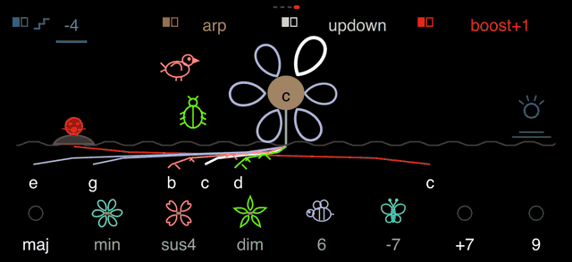

# Garden

A chord player for the OP-1 Field, as an [open-field](https://github.com/LaP0573/open-field) pack for OS 1.7.3.

Unofficial. Not made, endorsed or supported by Teenage Engineering, and not affiliated with them or with open-field.
Use at your own risk; see [LICENSE](LICENSE).

## Install

Put `garden.pack` (from [releases](../../releases)) in the unit's `packs` folder next to open-field's `base.pack`, and
restart. Hold **Help** while switching on to start without packs.

## Play

**Shift + Sequencer** lists **garden**. Hold a piano key to play the chord on that root; more keys play notes over it.

| Key | Page | Blue | Tan | Gray | Orange |
| --- | --- | --- | --- | --- | --- |
| T1 | play | cascade; Shift: echo (push: voice leading) | style; Shift: rate (push: hold) | voicing, order or phrase; Shift: the other (push: chord banks) | Boost; Shift: pulse (push: extension banks) |
| T2 | rhythm | loop | length | swing | human |
| T3 | palette | chord bank A | chord bank B | extension bank A | extension bank B |
| T4 | gardens | garden (push: plant) | root | kind | extension square (push: next) |

- Keys 1–4: chord kinds. Keys 5–8: extensions. Tap latches, hold is momentary.
- T3 push: the next unused cell. Shift + push: swap or reset the banks.
- T4: keys 1–8 play the gardens, Shift + key plants the chord there. Shift: blue walk length, tan walk order, blue push walks.
- **Help** shows the controls of the page you're on.

## Build

Set `OPEN_FIELD`, `OPEN_XY` and `TOOLCHAIN` in `local.env` ([open-xy](https://github.com/etcetc000/open-xy) provides
the toolchain), then run `./build.sh`. The pack is written to `out/garden.pack`.
